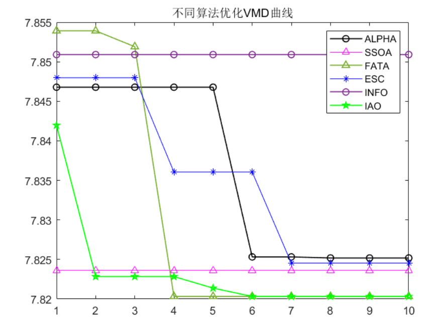
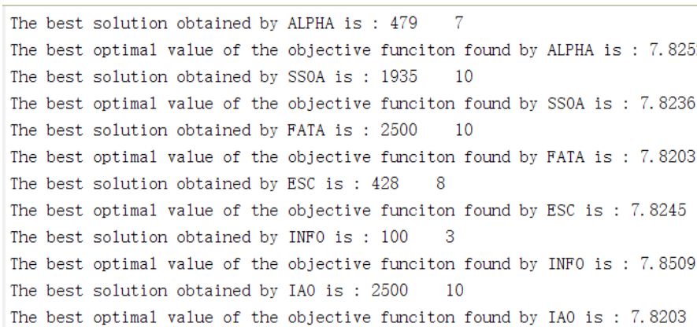
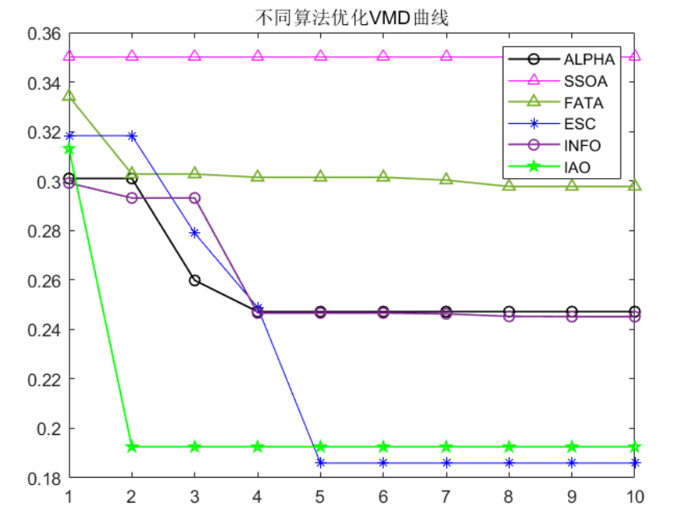
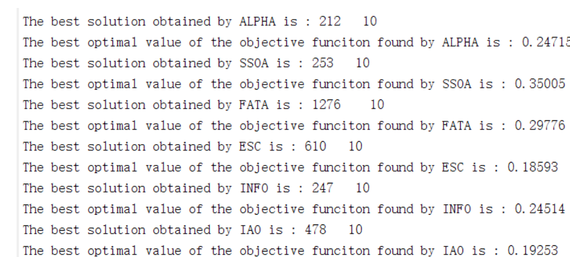
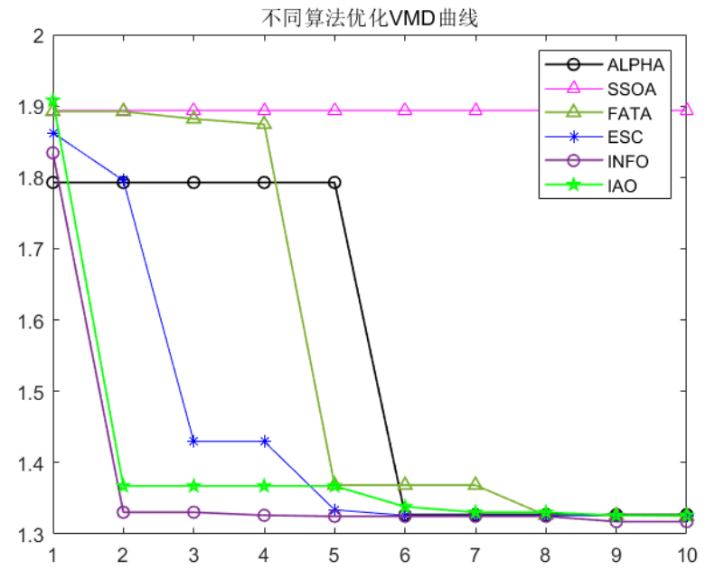
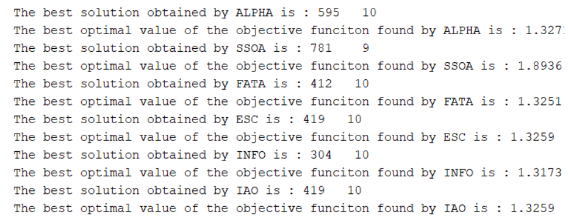
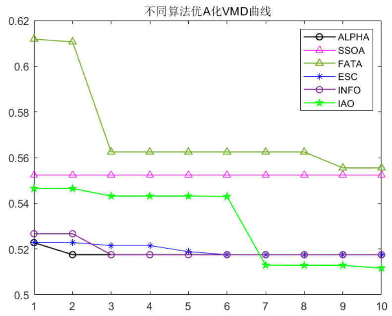
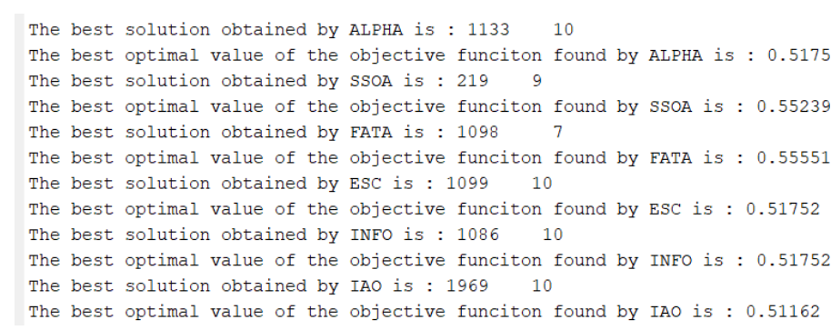
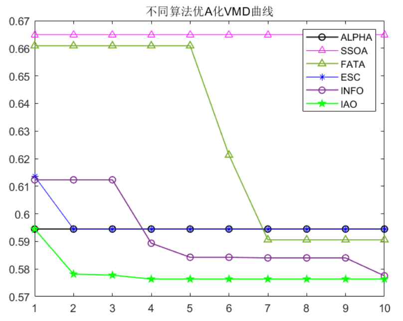
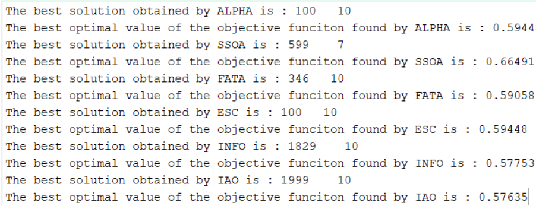

# 6 New Optimization Algorithms for VMD in 2024

In this issue, six new intelligent optimization algorithms for VMD were updated in the VMD family of products.
These six algorithms are all new ones published in 2024: Alpha Evolution Algorithm (ALPHA), Cooperative Swarm Optimization Algorithm (SSOA), Seashell Algorithm (FATA), Escape Optimization Algorithm (ESC), Vector Weighted Averaging Optimizer (INFO), and Information Acquisition Optimizer (IAO).
In this issue, six new algorithms for 2024 are used to optimize VMD parameters. Five fitness functions are selected for optimization, which determine the optimal values of k and α for VMD. The six fitness functions are: Minimized Entropy of Envelope, Minimized Entropy of Sample, Minimized Information Entropy, Minimized Arrangement Entropy, Arrangement Entropy/Mutual Information Entropy, which can be switched on one-click in the code.
Regarding which of the following should be chosen as the fitness function for oneself, you can refer to this article. Why does VMD need parameter optimization, minimum entropies/sample entropy/permutation entropy/information entropy, and what exactly should the fitness function be selected?
Results display:
1. Minimum Entropy as the fitness function
2. Minimum sample entropy as the fitness function
3. Minimum Entropy as the Fitness Function
4. Minimum Arrangement Entropy as the Fitness Function
5. Complex indicators (Permutation Entropy/Mutual Information Entropy) as fitness function
\n        \n      \n        \n  

## Images

<!-- PAYMENT_BLOCK -->

## Get this dataset

- Payment link (Stripe): [Buy now](https://buy.stripe.com/3cs8yP7sY87d0vu9AB)
- Payment QR code: 

<!-- /PAYMENT_BLOCK -->
